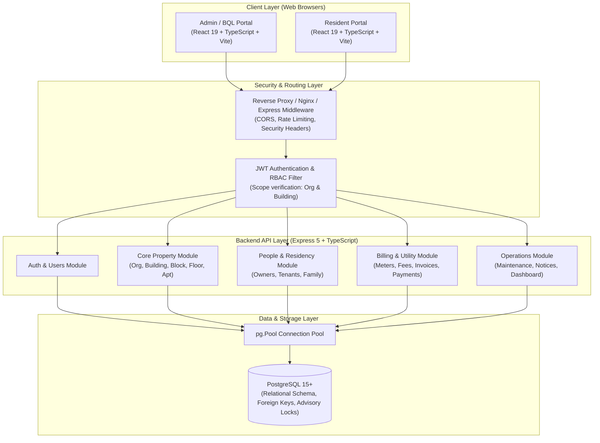

# Kiến trúc Hệ thống - SmartCondo

**Ngày cập nhật:** 03/11/2026  
**Phiên bản:** 1.0  
**Tác giả:** AI Software Architect & Senior Full-stack Developer  
**Dự án:** Smart Apartment & Condominium Digital Management Platform (SmartCondo)

---

## 1. Tổng quan Kiến trúc

SmartCondo được thiết kế theo kiến trúc **Layered Client-Server** hiện đại, phân tách rành mạch giữa giao diện người dùng (Frontend SPA), tầng xử lý nghiệp vụ & xác thực (Backend REST API) và tầng lưu trữ dữ liệu quan hệ (PostgreSQL Database).

---

## 2. Kiến trúc Tầng Backend (API Service)

### 2.1 Cấu trúc Phân tầng
1. **Entrypoint (`src/server.ts`):** Quản lý vòng đời tiến trình, đọc cấu hình môi trường, kiểm tra bí khóa JWT và chuỗi kết nối Database trước khi bind cổng HTTP.
2. **Application Configuration (`src/app.ts`):** 
   - Đặt các HTTP Security Headers (`x-request-id`, `x-content-type-options: nosniff`, `x-frame-options: DENY`, `referrer-policy: no-referrer`).
   - Kiểm soát CORS theo danh sách whitelist chặt chẽ (`ALLOWED_ORIGINS`).
   - Body parser an toàn (`limit: 1mb`).
   - Bộ gom lỗi toàn cục (Global Error Handler) dịch mã lỗi PostgreSQL (`23505` trùng khóa, `23503` vi phạm khóa ngoại, `23514` vi phạm CHECK constraint) thành định dạng chuẩn `{ success: false, error: { code, message } }`.
3. **Tầng Xác thực & Phân quyền (`src/auth/`):**
   - Đăng nhập bằng email/mật khẩu, so khớp mã băm bcrypt.
   - Phát hành cặp token: Access Token (thời hạn ngắn 15 phút) và Refresh Token (lưu bản ghi cơ sở dữ liệu, quay vòng khi refresh).
   - Middleware `authenticate`: Giải mã token, truy vấn quyền thực tế và scope hiện hành từ database, gán vào `request.auth`.
   - Middleware `requirePermission`: Chặn request nếu người dùng không sở hữu quyền cần thiết.
   - Hàm tiện ích `canAccessOrganization` và `canAccessBuilding`: Kiểm tra phạm vi dữ liệu cấp tổ chức hoặc tòa nhà của người dùng.
4. **Tầng Xử lý Nghiệp vụ (`src/modules/`):**
   - `core.routes.ts`: Tổ chức, tòa nhà, khối, tầng, căn hộ.
   - `people.routes.ts`: Quản lý con người, phân quyền sở hữu và cư trú có thời hạn.
   - `billing.routes.ts`: Ghi chỉ số tiện ích, bảng biểu phí, lập và phát hành hóa đơn theo kỳ, ghi nhận thanh toán.
   - `operations.routes.ts`: Tiếp nhận và cập nhật yêu cầu bảo trì, phát thông báo, dashboard tổng hợp số liệu.
   - `admin.routes.ts`: Quản lý tài khoản và phân quyền người dùng nội bộ.

---

## 3. Kiến trúc Tầng Giao diện (Frontend Web)

### 3.1 Thiết kế Độc lập theo Phân quyền
Frontend được tổ chức thành 2 phân hệ chuyên biệt:
- **Admin/Management Portal (Dành cho Ban Quản trị & Ban Quản lý):**
  - Bảng điều khiển vận hành tổng thể (tỷ lệ lấp đầy, doanh thu phí, cảnh báo bảo trì).
  - Cây phân cấp bất động sản trực quan (Building -> Block -> Floor -> Apartment).
  - Hồ sơ quản lý cư dân và chủ sở hữu theo từng căn hộ.
  - Trung tâm hóa đơn và theo dõi dòng tiền thanh toán.
  - Điều phối phiếu bảo trì và phân công kỹ thuật viên.
- **Resident Portal (Dành cho Cư dân & Chủ sở hữu):**
  - Giao diện thân thiện, tối ưu cho cả màn hình di động lẫn máy tính bảng, desktop.
  - Xem thông tin căn hộ, hợp đồng cư trú.
  - Tra cứu hóa đơn dịch vụ, lịch sử thanh toán, thực hiện thanh toán trực tuyến mô phỏng.
  - Gửi yêu cầu phản ánh sửa chữa, theo dõi tiến độ xử lý theo thời gian thực.
  - Nhận bảng tin thông báo từ tòa nhà.

### 3.2 Bộ Quy tắc Thiết kế (Design System)
- **Bảng màu:** Màu chủ đạo Deep Charcoal (`#1A1F2E`), màu nhấn Cyan (`#00B8D9`), màu cảnh báo Amber (`#F2A95C`), màu thành công Emerald (`#22C55E`), màu viền Slate (`#E2E8F0` / `#334155`).
- **Kiểu chữ:** Tiêu đề sử dụng Space Grotesk (hiện đại, công nghiệp, vững chãi), nội dung sử dụng Inter (dễ đọc, tối ưu hiển thị số liệu).
- **Trải nghiệm người dùng:** Tránh hoàn toàn các giao diện AI mặc định (không lạm dụng card bo tròn đổ bóng mờ, không viết hoa toàn bộ nhãn vô nghĩa, trạng thái rỗng và thông báo lỗi rõ ràng bằng tiếng Việt).

---

## 4. Kiến trúc Dữ liệu & Đảm bảo Tính toàn vẹn

1. **Quan hệ Đa cấp có Ràng buộc Toàn vẹn:**
   - Mọi thực thể liên kết đều sử dụng khóa ngoại (`REFERENCES ... ON DELETE RESTRICT / CASCADE`).
   - Khóa duy nhất phức hợp (Composite Unique Keys) ngăn chặn trùng mã trong cùng phạm vi (ví dụ: mã khối trong một tòa nhà, mã căn hộ trong một tầng).
2. **Tách biệt Chủ sở hữu và Người cư trú:**
   - Bảng `people` lưu thông tin nhân thân độc lập với tài khoản đăng nhập (`users`).
   - Bảng `apartment_ownerships` quản lý tỷ lệ sở hữu và thời hạn (`valid_from`, `valid_to`).
   - Bảng `apartment_residencies` quản lý mối quan hệ cư trú (`OWNER`, `TENANT`, `FAMILY`, `OTHER`) kèm quyền hạn xem hóa đơn (`can_view_bills`) và quyền trả phí (`can_pay_bills`).
3. **Xử lý Giao dịch Tài chính & Đồng thời:**
   - Mọi thao tác sinh hóa đơn theo kỳ được đóng gói trong Transaction với cơ chế khóa hàng.
   - Thao tác ghi nhận thanh toán kiểm tra số dư còn nợ, cập nhật trạng thái `PAID` / `PARTIAL` và hỗ trợ `Idempotency-Key` ngăn trùng lặp giao dịch do bấm nhiều lần.

---

## 5. Kiến trúc Triển khai (Deployment & DevOps)

Hệ thống được đóng gói container hóa hoàn chỉnh:
- **Dockerfile:** Multi-stage build cho Node.js + TypeScript Backend, tạo container runtime gọn nhẹ và bảo mật.
- **Compose (`compose.yaml`):** 
  - Service `postgres`: PostgreSQL 17 Alpine với cấu hình volume lưu trữ bền vững và healthcheck tự động.
  - Service `api`: Chạy backend kết nối với database thông qua mạng nội bộ Docker.
  - Cấu hình biến môi trường qua `.env` tách biệt với mã nguồn.

