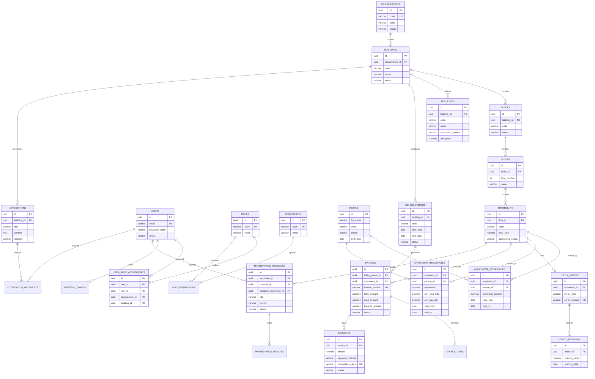

# Mô hình Dữ liệu Quan hệ (ERD) - SmartCondo

**Ngày cập nhật:** 03/11/2026  
**Phiên bản:** 1.0  
**Tác giả:** AI Software Architect & Senior Full-stack Developer  
**Dự án:** Smart Apartment & Condominium Digital Management Platform (SmartCondo)

---

## 1. Sơ đồ Quan hệ Thực thể (ERD Diagram)

---

## 2. Từ điển Dữ liệu Chi tiết (Data Dictionary)

### 2.1 Nhóm Phân cấp Bất động sản
- **`organizations`**: Lưu trữ các đơn vị quản lý vận hành hoặc chủ đầu tư. Khóa chính `id` (UUID), `code` là duy nhất toàn cục.
- **`buildings`**: Tòa nhà thuộc một tổ chức. Ràng buộc `UNIQUE (organization_id, code)` đảm bảo mã tòa nhà không trùng lặp trong cùng tổ chức.
- **`blocks`**: Khối tháp thuộc tòa nhà. Ràng buộc `UNIQUE (building_id, code)`.
- **`floors`**: Tầng thuộc khối tháp. Ràng buộc `UNIQUE (block_id, floor_number)`.
- **`apartments`**: Căn hộ cụ thể. Ràng buộc `UNIQUE (floor_id, code)`. Lưu thông tin `area_sqm` (diện tích sàn), `bedroom_count`, `bathroom_count`, `operational_status` (`ACTIVE`, `MAINTENANCE`, `INACTIVE`).

### 2.2 Nhóm Con người & Quan hệ Pháp lý Căn hộ
- **`people`**: Nhân thân cá nhân (Họ tên, email, số điện thoại, ngày sinh, địa chỉ). Đảm bảo tính độc lập giữa nhân thân và tài khoản đăng nhập.
- **`apartment_ownerships`**: Quan hệ sở hữu căn hộ. Một căn hộ có thể có nhiều đồng sở hữu (`ownership_percent`). Ràng buộc thời hạn `valid_from` và `valid_to`, kiểm tra `CHECK (valid_to IS NULL OR valid_to >= valid_from)`.
- **`apartment_residencies`**: Quan hệ cư trú thực tế tại căn hộ. Quan hệ `relationship` phân loại: `OWNER`, `TENANT`, `FAMILY`, `OTHER`. Kèm cờ phân quyền hóa đơn `can_view_bills` và `can_pay_bills`.

### 2.3 Nhóm Người dùng, Vai trò & Phân quyền
- **`users`**: Tài khoản đăng nhập hệ thống (`email`, `password_hash`, `status`: `ACTIVE`, `LOCKED`, `DISABLED`).
- **`roles`**: Vai trò chức danh (`SUPER_ADMIN`, `BUILDING_MANAGER`, `TECHNICIAN`, `BOARD_MEMBER`, `OWNER`, `RESIDENT`).
- **`permissions`**: Quyền năng cụ thể dạng `scope:action` (ví dụ: `building:read`, `billing:manage`, `maintenance:submit`).
- **`user_role_assignments`**: Gán vai trò cho người dùng kèm phạm vi: `organization_id` (cấp tổ chức) hoặc `building_id` (cấp tòa nhà).
- **`refresh_tokens`**: Token làm mới phiên đăng nhập hỗ trợ thu hồi (`revoked_at`) và chống phát lại token cũ.

### 2.4 Nhóm Chỉ số Tiện ích, Biểu phí, Hóa đơn & Thanh toán
- **`utility_meters`**: Đồng hồ đo điện, nước gắn liền từng căn hộ (`meter_type`: `ELECTRIC`, `WATER`, `serial_number` duy nhất).
- **`utility_readings`**: Lịch sử chốt chỉ số. Ràng buộc giá trị không âm và kiểm tra tính đơn điệu không giảm lùi theo thời gian.
- **`fee_types`**: Các loại phí dịch vụ của tòa nhà. Hỗ trợ phương pháp tính `calculation_method`: `FIXED`, `PER_SQM`, `METER_TIERED`, `VARIABLE`.
- **`billing_periods`**: Kỳ tính phí theo tháng/quý của tòa nhà (`DRAFT`, `GENERATED`, `ISSUED`, `CLOSED`).
- **`invoices`**: Hóa đơn phát hành cho từng căn hộ trong kỳ tính phí. Lưu vết `total_amount`, `paid_amount`, `balance_amount` và `status` (`DRAFT`, `ISSUED`, `PARTIAL`, `PAID`, `CANCELLED`).
- **`invoice_items`**: Chi tiết từng dòng phí trong hóa đơn.
- **`payments`**: Bản ghi thanh toán. Hỗ trợ `idempotency_key` (chống thanh toán trùng lặp khi retry mạng), lưu vết số tiền và kênh thanh toán.

### 2.5 Nhóm Vận hành, Bảo trì & Thông báo
- **`maintenance_requests`**: Phiếu yêu cầu sửa chữa, phản ánh của căn hộ (`PENDING`, `APPROVED`, `ASSIGNED`, `IN_PROGRESS`, `COMPLETED`, `CANCELLED`). Có liên kết kỹ thuật viên phụ trách `assigned_technician_id` bắt buộc thuộc cùng tòa nhà.
- **`maintenance_updates`**: Lịch sử chuyển trạng thái và trao đổi kỹ thuật.
- **`notifications`**: Thông báo do Ban quản lý phát hành gửi cư dân theo phạm vi tòa nhà hoặc căn hộ.
- **`notification_recipients`**: Trạng thái đọc của từng tài khoản người nhận.
- **`audit_logs`**: Nhật ký lưu vết thay đổi dữ liệu quan trọng phục vụ tra cứu bảo mật.

---

## 3. Ràng buộc Toàn vẹn Dữ liệu (Integrity Constraints)

1. **Khóa ngoại nghiêm ngặt:** Tất cả các bảng con đều có ràng buộc `FOREIGN KEY` trỏ về bảng cha, không cho phép bản ghi mồ côi (orphaned records).
2. **Kiểm tra nghiệp vụ (CHECK Constraints):**
   - Diện tích căn hộ `area_sqm > 0`.
   - Tỷ lệ sở hữu `ownership_percent > 0 AND ownership_percent <= 100`.
   - Thời hạn hiệu lực `valid_to IS NULL OR valid_to >= valid_from`.
   - Số tiền hóa đơn và thanh toán `amount >= 0`.
3. **Chỉ mục tối ưu hiệu năng:** Tạo index trên các cột thường xuyên tìm kiếm hoặc lọc theo phạm vi (`organization_id`, `building_id`, `apartment_id`, `person_id`, `status`).

